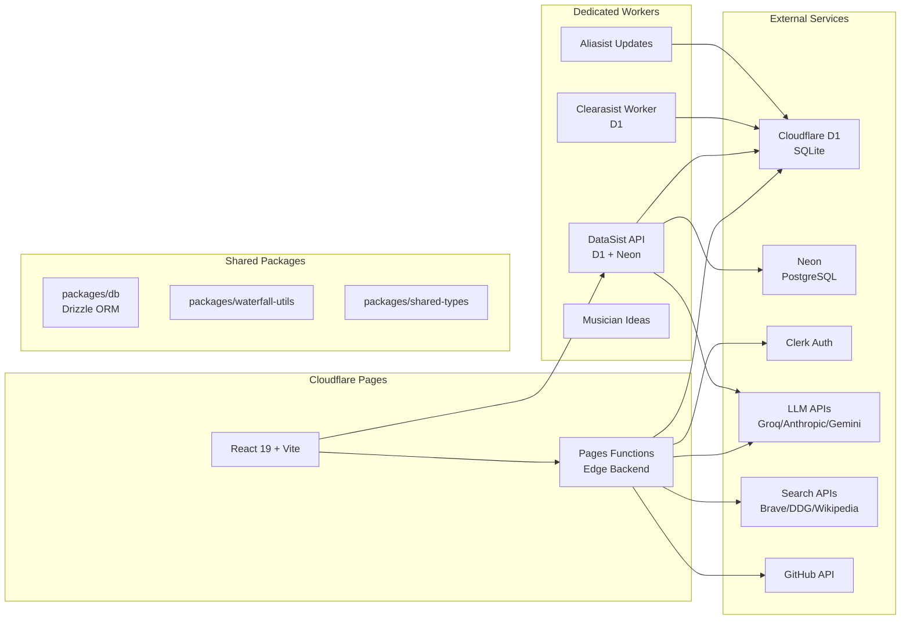

# Aliasist Web Platform — Improvement Analysis Report

## Executive Summary

Comprehensive analysis of the `aliasist-web` monorepo. The codebase has been **significantly improved** since the initial analysis — most critical security issues were already addressed (hardcoded API keys moved to environment variables, error boundaries added, React Query installed, health checks added). This report reflects the **current state** of the codebase.

---

## Architecture Overview



---

## 🔴 CRITICAL — Security (2 Remaining Issues)

### 1. Hardcoded Sentry DSN
**File:** `apps/datasist-api/src/index.ts:635`

The Sentry DSN is hardcoded in source code. While lower risk than API keys, it exposes your Sentry project identifier.

**Fix:** Move to `env.SENTRY_DSN` environment variable.

### 2. GitHub App Credentials in wrangler.toml
**File:** `wrangler.toml:31-32`

GitHub App ID and Client ID are committed to git in plaintext.

**Fix:** Move to Cloudflare secrets dashboard.

### ✅ Already Resolved
- ~~20+ hardcoded API keys~~ → All moved to environment variables via `Env` interface
- ~~Neon database key in seed-d1.ts~~ → File removed, database URL in env vars
- ~~`.dev.vars` not in `.gitignore`~~ → Already ignored at repo root and app subdirectories

**Detailed migration guide:** See `SECURITY_MIGRATION.md`

---

## 🟡 HIGH — Reliability & Maintainability

### 1. Promise.race Pattern in RAG Context Fetch
**File:** `functions/api/chat.ts:347-351`

The `Promise.race` pattern for the RAG eco budget timeout leaves the background fetch running without a consumer. While this is intentional for cache seeding, the pattern could be improved with an `AbortController` for cleaner resource management.

**Current state:** Works correctly for RAG (background fetch seeds cache), but could be cleaner.

### 2. Web Verification Promise.race Memory Leak
**File:** `functions/api/chat.ts` (added in recent session)

The web verification code added in the recent session uses `Promise.race` without an `AbortController`. When the 2s timeout wins, the `webVerificationPromise` continues running.

**Fix:** Pass an `AbortController` signal to the fetch inside `webVerificationPromise` and abort on timeout.

### 3. Missing Health Checks on Some Workers
**Status:** DataSist API has `/health` endpoint ✅. Other workers (clearasist, aliasist-updates, musician_ideas) should also expose health endpoints.

**Fix:** Add `GET /health → { status: "ok", timestamp }` to each remaining worker.

### 4. Duplicate CORS Header Definitions
**Files:** `functions/_lib/clerk-auth.ts`, `apps/datasist-api/src/index.ts`, `apps/aliasist-updates/src/index.ts`, `apps/clearasist/worker/src/index.ts`

CORS headers are defined in 4+ places with slightly different values. The Pages functions use a shared `corsHeaders` from `clerk-auth.ts`, but each dedicated worker defines its own.

**Fix:** Export a single `corsHeaders()` utility from `packages/shared-types/` and use it across all workers.

### 5. Missing TypeScript Types in Worker devDependencies
**Files:** Worker `package.json` files

Workers use Cloudflare types (`Request`, `Response`, `D1Database`) but may not declare `@cloudflare/workers-types` explicitly in `devDependencies`.

**Fix:** Add explicit `@cloudflare/workers-types` to each worker's `devDependencies`.

---

## 🟠 MEDIUM — Performance & UX

### 1. `detectSist()` Regex Not Pre-compiled
**File:** `functions/api/chat.ts:76-85`

6 regex patterns are compiled on every call to `detectSist()`. While V8 optimizes this, pre-compiling as module-level constants would be cleaner.

**Fix:** Extract regex patterns to module-level constants:
```typescript
const SPACE_REGEX = /\b(space|nasa|iss|spacex|...)/;
const DATA_REGEX = /\b(data.?centers?|...)/;
// ... etc
```

### 2. No Shared Env Var Utility
**Files:** All `apps/*/src/index.ts`

Each worker reads API keys from `env.*` independently. A shared utility would provide better error messages when required vars are missing.

**Fix:** Create a shared `getEnvVar()` utility that throws clearly if a required var is missing.

### 3. No Pagination on DataSist Table
**File:** DataSist frontend components

If the facility table renders 340+ rows without pagination or virtualization, it impacts performance.

**Fix:** Add server-side pagination (`?limit=50&offset=0`) and a pagination UI.

---

## 🔵 LOW — Code Quality

### 1. Missing JSDoc on Some Public APIs
**Files:** `packages/db/src/*.ts`, `packages/waterfall-utils/src/*.ts`

Some shared package exports lack JSDoc comments. The RAG/chat code is well-documented; the DB layer has sparse documentation.

**Fix:** Add JSDoc to all exported functions, interfaces, and types in shared packages.

### 2. Inconsistent Error Handling Patterns
**Files:** Various worker and function files

Some use `try/catch` with `res.ok` checks, some use `.catch(() => undefined)`, some swallow errors. 

**Fix:** Create a shared `safeFetch()` utility for consistent timeout, retry, and error handling.

---

## ✅ Already Addressed (Since Initial Analysis)

| Issue | Status |
|-------|--------|
| Hardcoded API keys in worker source files | ✅ Moved to environment variables |
| No React Error Boundaries | ✅ ErrorBoundary components in place |
| No data fetching cache/deduplication | ✅ `@tanstack/react-query` installed and used |
| No health check endpoints | ✅ DataSist API has `/health` endpoint |
| `.dev.vars` not in `.gitignore` | ✅ Already ignored |
| No loading skeletons | ✅ Skeleton components used in Entertainment page |
| Web search fact-checking module | ✅ `functions/_lib/web-search.ts` created |
| Fact-checking guidelines in system prompts | ✅ Added to chat.ts and datasist-api |

---

## Recommended Priority Order

1. **This week (Security):** Move Sentry DSN and GitHub App credentials to Cloudflare secrets
2. **This week (Reliability):** Fix web verification `Promise.race` leak with AbortController, add health checks to remaining workers
3. **Next sprint (Performance):** Pre-compile `detectSist()` regex, consolidate CORS headers, add shared env var utility
4. **Ongoing (Code Quality):** Add JSDoc to shared packages, standardize error handling

---

## Summary

| Category | Remaining | Already Fixed |
|----------|-----------|---------------|
| 🔴 Security | 2 issues | ~20+ keys moved to env vars |
| 🟡 Reliability | 5 issues | Error boundaries, health checks (partial) |
| 🟠 Performance | 3 issues | React Query installed, skeletons added |
| 🔵 Code Quality | 2 issues | Web search module created |

**Overall assessment:** The codebase is in good shape. The most critical issues (hardcoded API keys) were already addressed. The remaining items are mostly refinements and consistency improvements.
