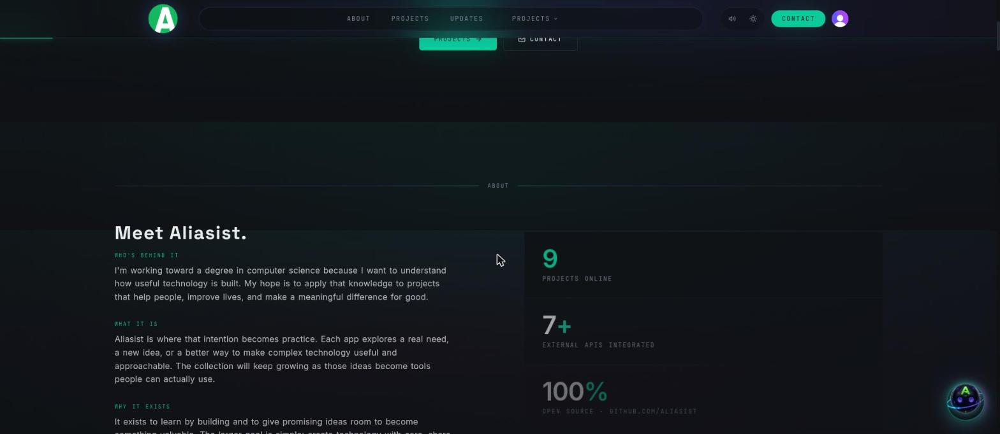

# Aliasist


**Aliasist** is my homepage, the front door to everything else I've built. One stop to see the whole suite and jump into whatever you're after.

## What it actually looks like



## The suite

Everything listed on the homepage comes from `src/content/homepage.ts`:

- **Aliasist AI**: chat, image generation, and answers pulled from real documents, at `www.aliasist.tech`.
- **Globalize**: data centers, environmental data, and media on a 3D globe, at `www.aliasist.world`.
- **SpaceSist**: a live space dashboard, at `space.aliasist.com`.
- **ClearSist**: strips metadata out of your files right in the browser, at `clearasist.pages.dev` (the folder and project are still called `clearasist`).
- **PDFSist**: fill in and sign PDFs right in the browser, at `pdf.aliasist.com`.
- **Files Abductor**: my desktop downloader. Installers are on the public `files-abductor` releases page.
- **spawnOS**: a browser version of my bare-metal OS, at `www.aliasist.com/os`. Every web app above opens in its own window.

That's five web apps and one desktop app. I'm holding off on new projects until 2027 and putting my time into making these better. The DataSist, PulseSist, and EcoSist folders are older apps I'm keeping around, not part of what's on the homepage now.

[docs/SUITE_STATUS.md](docs/SUITE_STATUS.md) lists where each app's code lives, how to check it, and how it ships.

## Related repositories

- **[`files-abductor`](https://github.com/aliasist/files-abductor)** (public): the Files Abductor installers. The download buttons on the homepage point there, so no binaries live in this repo.
- **`verity-console`** (private): my dashboard for curating the documents my AI chat tools answer from.

## Tech stack

- React + Vite + TypeScript
- Tailwind CSS + Radix UI
- Cloudflare Pages + Functions (Wrangler)
- Clerk sign-in

## What's where

- `src/`: homepage UI and routing
- `public/`: static files and images (`public/os/` is spawnOS)
- `functions/`: Cloudflare Pages Functions (the `/api/*` routes)
- `apps/`: the other apps and experiments
- `assets/`: images for promo stuff

## Running it locally

### Quickstart

- Install: `npm ci`
- Local keys: `cp .dev.vars.example .dev.vars`, then fill them in
- Run: `npm run dev` (Vite on `http://localhost:8080`)
- Health check: `npm run doctor`

### Commands

- `npm run dev`: homepage dev server (port 8080)
- `npm run preview`: build, then serve it like production with `wrangler pages dev dist`
- `npm test`: unit tests
- `npm run lint`: ESLint, zero warnings allowed
- `npm run check`: lint, tests, production build, and the JavaScript size budget
- `npm run setup:clearasist`: install ClearSist's own dependencies
- `npm run build:clearasist`: typecheck and build ClearSist
- `npm run check:suite`: check every app locally and save a dated report
- `npm run status:suite -- --live`: see each repo's state and what the live sites are serving, without deploying anything

### ClearSist

ClearSist installs and builds on its own:

```sh
npm run setup:clearasist
npm run build:clearasist
npm --prefix apps/clearasist run dev
```

The older apps still have their scripts so I can maintain them. Check `docs/SUITE_STATUS.md` for where each live app's code actually lives, since some old folders have similar names but aren't the same code.

## Environment variables

- `.dev.vars`: local Pages Functions and Clerk keys (copy from `.dev.vars.example`)
- `.env.local`: local Vite variables (copy from `.env.example`)
- The agent dashboard needs `ALIASIST_ADMIN_USER_IDS` and the server-only `AGENT_PUSH_SECRET`.

## Deploying

Pushing to `master` runs `.github/workflows/deploy-homepage.yml`, which runs `npm run check` and then publishes to the Pages project `aliasistabductor`. Pull requests get checked but never deployed. `npm run deploy` runs the same checks before publishing by hand.

ClearSist has its own workflow and lockfile. The other apps live in their own repos and ship on their own, so pushing here doesn't deploy them. After a deploy, open the live site and click through it. A passing build doesn't always mean the domain is serving the new version yet.

## Contributing

See [CONTRIBUTING.md](CONTRIBUTING.md) for setup, checks, and pull requests.

## Security

Found a security problem? Email me at dev@aliasist.com instead of opening an issue. See [SECURITY.md](SECURITY.md).

## License

This repository is proprietary. See [LICENSE](LICENSE).
