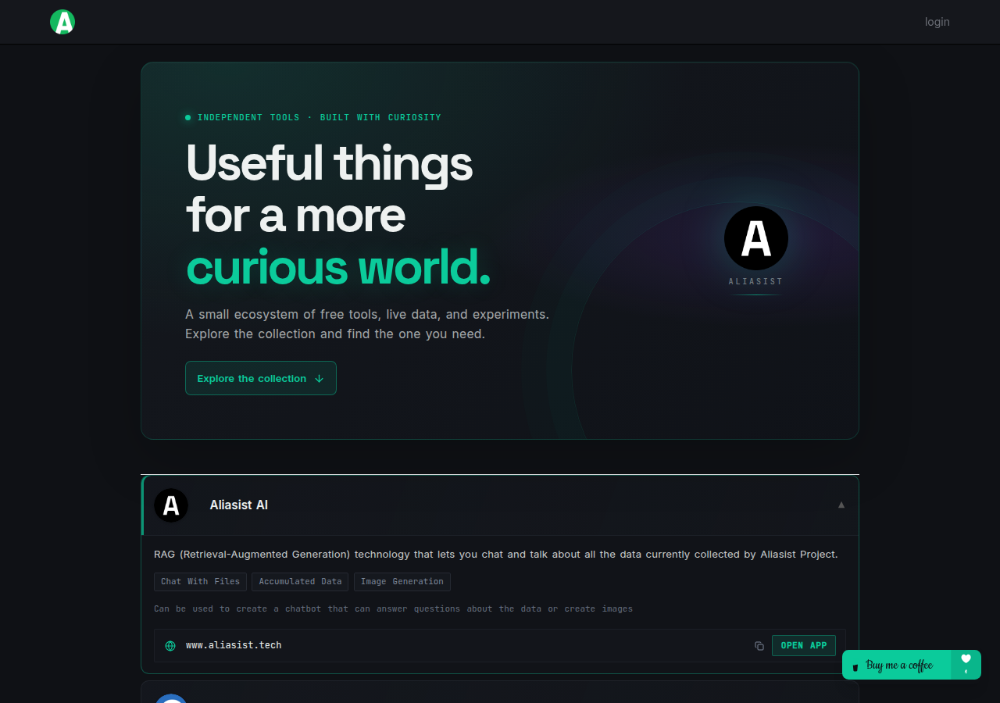

# Aliasist



> **Useful things for a more curious world.**  
> A small ecosystem of free tools, live data, and experiments built with curiosity and respect for privacy.

**Aliasist** (`aliasist.com`) is an independent directory and hub for my suite of web applications, geospatial monitors, browser-native privacy tools, and desktop software.

---

## The Philosophy

Everything in the Aliasist directory follows three straightforward rules:

1. **Your files stay on your device:** When you use tools like **PDFSist** or **ClearSist**, everything runs directly inside your web browser via client-side Web APIs and WebAssembly. Your photos, documents, and sensitive files are never uploaded to any server.
2. **No tracking:** Zero ads, zero tracking cookies, zero analytics scripts, and zero personal data collection on this site.
3. **Just useful tools:** Each tool has a focused job. Client-side tools require no account or sign-up; live monitors connect directly to open public data feeds.

> [!NOTE]
> **Active Focus:** New project creation is on hold until 2027. All development is dedicated to keeping the six tools in this directory fast, solid, and reliable.

---

## The Directory

The live directory lists five web applications and one desktop app:

| App | Status & Badge | Live URL / Access | Description |
| :--- | :--- | :--- | :--- |
| **Aliasist AI** | `Smart Search` · `Reads Your Files` | [www.aliasist.tech](https://www.aliasist.tech) | RAG (Retrieval-Augmented Generation) chat system and image generation grounded in curated documents with full source citations. |
| **Globalize** | `3D Globe` · `Live World Map` | [www.aliasist.world](https://www.aliasist.world) | Real-time 3D Earth visualization tracking subsea fiber cables, global data centers, live civil aviation (ADSB/OpenSky), earthquakes (USGS), wildfires (NASA FIRMS), and city webcams. |
| **SpaceSist** | `Space` · `Live Tracking` | [space.aliasist.com](https://space.aliasist.com) | Orbital dashboard tracking the International Space Station, upcoming rocket launch countdowns, and NASA/SpaceX mission data. |
| **ClearSist** | `Privacy` · `100% Private` | [clearasist.pages.dev](https://clearasist.pages.dev) | Strips hidden EXIF, geolocation, and camera metadata from photos, PDFs, and Office documents before sharing. 100% in-browser. |
| **PDFSist** | `PDF Tool` · `No Sign-Up` | [pdf.aliasist.com](https://pdf.aliasist.com) | Browser-native PDF signing, annotation, and form filling. Draw or type signatures and export signed documents without uploading files to the cloud. |
| **Files Abductor** | `Desktop` · `Download` | [GitHub Releases](https://github.com/aliasist/files-abductor/releases/tag/v2.7.0) | Cross-platform desktop media and file downloader powered by Python and `yt-dlp`. Prebuilt binaries available for Linux (AppImage, Snap) and Windows (.exe). |

---

## Repository Structure

```
aliasist-web/
├── src/
│   ├── assets/              # Logos, brand marks, and iconography
│   ├── components/          # Navbar, Footer, BuyMeACoffee, ErrorBoundary
│   ├── config/              # Site endpoints and API routes
│   ├── content/             # homepage.ts (canonical directory definitions)
│   ├── index.css            # Dark/light theme HUD styling & directory cards
│   ├── pages/               # Index.tsx (directory, about, contact) & subpages
│   └── App.tsx              # Router setup and providers
├── functions/               # Cloudflare Pages Functions
│   └── api/                 # /api/chat (RAG proxy & caching), /api/contact
├── apps/                    # Monorepo workspaces & standalone tools
│   ├── clearasist/          # ClearSist standalone web client
│   ├── datasist/            # Data center research workspace
│   ├── spacesist/           # Space telemetry workspace
│   └── pulsesist/           # Signals & market intelligence workspace
├── public/                  # Static assets and favicons
│   └── os/                  # spawnOS browser environment
├── scripts/                 # Health checks, test runners, and suite monitors
│   ├── browser-smoke.mjs    # Headless browser verification
│   └── check-suite.mjs      # Workspace multi-repo validator
└── docs/                    # Technical architecture & deployment guides
```

---

## Tech Stack

* **Frontend:** React 18, Vite 8, TypeScript 5.8
* **Styling & UI:** Tailwind CSS, Radix UI Primitives, Framer Motion, Lucide Icons
* **Runtime & Hosting:** Cloudflare Pages + Cloudflare Pages Functions (Wrangler)
* **Auth:** Optional Clerk sign-in integration
* **Testing:** Vitest, Playwright browser smoke suite

---

## Local Development

### Prerequisites

* Node.js 20+
* npm 10+

### Quickstart

1. **Install dependencies:**
   ```bash
   npm ci
   ```

2. **Configure environment keys:**
   ```bash
   cp .dev.vars.example .dev.vars
   cp .env.example .env.local
   ```

3. **Start local dev server:**
   ```bash
   npm run dev
   ```
   The site will be available at `http://localhost:8080`.

4. **Run health doctor:**
   ```bash
   npm run doctor
   ```

---

## Available Scripts

| Command | Description |
| :--- | :--- |
| `npm run dev` | Starts the Vite development server (port 8080) |
| `npm test` | Runs the Vitest test suite (`npm run test:watch` for watch mode) |
| `npm run lint` | Runs ESLint across the codebase (zero warnings permitted) |
| `npm run build` | Compiles the Vite frontend and Cloudflare Pages Functions |
| `npm run preview` | Builds and serves the project locally using `wrangler pages dev dist` |
| `npm run check` | Complete CI verification: `lint` + `test` + `build` + `check:bundle` |
| `npm run setup:clearasist` | Installs dependencies for ClearSist (`apps/clearasist`) |
| `npm run build:clearasist` | Compiles and builds ClearSist |
| `npm run check:suite` | Runs automated verification across all suite repos and logs a report |
| `npm run status:suite -- --live` | Inspects live domain status and Git commits across the suite without deploying |
| `npm run test:browser` | Headless browser smoke test validating navigation and UI fit |

---

## Deployment

The website is hosted on **Cloudflare Pages** (Project: `aliasistabductor`):

* **Automated CI/CD:** Pushes to the `master` branch trigger `.github/workflows/deploy-homepage.yml`. The workflow runs `npm run check` and automatically deploys passing builds to production.
* **Manual Deploy:**
  ```bash
  npm run deploy
  ```
  Runs full local verification before deploying via Wrangler.

---

## Contact & Security

* **Contact Form:** Use the form at the bottom of the homepage or email [dev@aliasist.com](mailto:dev@aliasist.com).
* **Security Reports:** Please report any vulnerabilities responsibly to [dev@aliasist.com](mailto:dev@aliasist.com) rather than opening public GitHub issues. See [SECURITY.md](SECURITY.md) for details.

---

## License

This repository and its codebase are proprietary. See [LICENSE](LICENSE).
